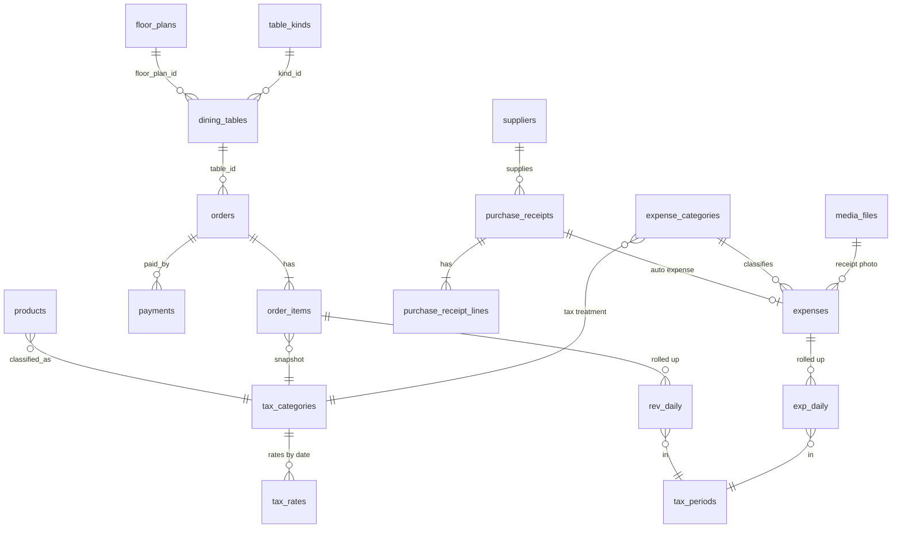

# Kiến trúc tổng thể: Thuế · Chi phí vận hành (OPEX) · Sơ đồ bàn 2.5D

Ngày soạn: 17/10/2026. Nền: Node.js/Express + MySQL trên Hostinger, Flutter (Riverpod 3, go_router, sqflite, dio).
Tài liệu này **hợp nhất và cập nhật** hai bản trước ([thuế HKD](thiet-ke-bao-cao-thue-hkd.md), [sơ đồ bàn 2.5D](thiet-ke-so-do-ban-2-5d.md)), bám vào những gì **đã có trong code** (mục 1) để chỉ làm phần còn thiếu. Không phải tư vấn thuế: tỷ lệ, ngưỡng, mẫu sổ phải được kế toán xác nhận (mục 9).

## 0. Điều chỉnh tiền đề pháp lý (đọc trước)

Đề bài dựa trên TT 40/2021 và TT 88/2021. Theo các nguồn tư vấn tra ngày 17/10/2026 (chưa đối chiếu văn bản gốc): từ 01/01/2026 thuế khoán bị bãi bỏ (Nghị quyết 198/2025/QH15), chế độ kế toán HKD do **TT 152/2025/TT-BTC** thay TT 88/2021; ngưỡng miễn GTGT/TNCN là 500 triệu/năm và có nguồn nói đã nâng lên 1 tỷ (NĐ 141/2026 sửa NĐ 68/2026). → **Mọi tỷ lệ, ngưỡng, mã sổ là dữ liệu cấu hình có hiệu lực theo ngày**, không nằm trong code.

## 1. Hiện trạng (đã làm trong CoCoffee)

| Thành phần | Bảng / module đã có | Ghi chú cho kiến trúc mới |
|---|---|---|
| Bàn | `dining_tables` (`status`, `current_order_id`, `merged_into`), ghép / tách bàn, đơn tạm | Sơ đồ 2.5D chỉ thêm cột tọa độ |
| Đơn & doanh thu | `orders`, `order_items` (giá, COGS đóng băng lúc hoàn tất), `payments` (sổ quỹ, gồm trả trước / hoàn tiền), `shifts` (chốt ca) | `order_items` chưa có snapshot thuế |
| Chi phí hàng nhập | `suppliers`, `purchase_receipts`, `purchase_receipt_lines`, `supplier_payments` (công nợ), `inventory_movements` | Đây đã là **chi phí nguyên vật liệu** có nhà cung cấp |
| Chi phí khác | **chưa có** (lương, thuê mặt bằng, điện nước…) | Phần mới của tài liệu này |
| Ảnh | `media_files` (BLOB trong MySQL, `/media/<id>` cache `immutable`) | Dùng cho ảnh chứng từ và mặt bằng |
| Hồ sơ HKD | `app_settings` `shop.*`: tên, chủ hộ, MST, số giấy ĐKKD, địa chỉ, ngành nghề, kỳ kê khai | Là `tax_profile` của bản thiết kế thuế |
| Vết | `audit_log` | Ghi khóa kỳ, sửa chi phí |

## 2. Lược đồ tổng thể (Tables ↔ Orders ↔ Revenues/Taxes ↔ Expenses)



Chuỗi dữ liệu: **bàn → đơn → dòng món (có nhóm thuế) → `rev_daily` → `tax_periods`**; **phiếu nhập / chi phí → `expenses` (mã thuế) → `exp_daily` → `tax_periods`**; báo cáo lấy hai rollup đó, không quét giao dịch.

## 3. Danh mục chi phí + giao dịch chi phí (OPEX)

| Bảng | Cột chính | Ghi chú |
|---|---|---|
| `expense_categories` | `id`, `code`, `name`, `parent_id`, `tax_treatment` ENUM(`deductible`,`non_deductible`,`capex`), `ledger_code` VARCHAR(20), `tax_category_id` NULL, `sort`, `is_active` | Mapping mã thuế/sổ: `ledger_code` là mã sổ do kế toán đặt (đổi theo thông tư mà không sửa code). Seed: nguyên vật liệu, bao bì, nhân công, thuê mặt bằng, điện nước, marketing, sửa chữa, khấu hao, khác |
| `expenses` | `id`, `expense_date`, `category_id`, `amount` DECIMAL(14,2), `vat_included` TINYINT, `payee` VARCHAR(120), `supplier_id` NULL, `purchase_receipt_id` NULL UNIQUE, `doc_no`, `note`, `receipt_media_id` NULL, `receipt_sha256` CHAR(64) NULL, `status` ENUM(`posted`,`void`), `created_by`, `created_at`, `voided_by`, `void_reason` | `purchase_receipt_id` UNIQUE: mỗi phiếu nhập sinh **đúng một** chi phí `nguyên vật liệu` (idempotent). Hủy = `void` + dòng audit, không xóa |
| `exp_daily` | PK(`day`, `category_id`): `amount`, `tx_count`, `updated_at` | Rollup, xem mục 4 |

Chi phí tự sinh từ `purchase_receipts`: khi lập phiếu (đã có transaction) thêm một dòng `expenses` cùng transaction, ngày = ngày phiếu, số tiền = `total` (chi phí ghi nhận khi nhập, không phải khi trả; công nợ nằm ở `supplier_payments`).

**Ảnh chứng từ:** app nén trước (cạnh dài ≤ 1600 px, JPEG q≈70, ≤ ~300 KB) → `POST /api/expenses/:id/receipt` bytes thô → `media_files` (folder `expense`) → `receipt_media_id`. Chặn trùng bằng `receipt_sha256`. Dọn ảnh của chi phí `void` sau 90 ngày.

## 4. Aggregation bất đồng bộ (không SUM trực tiếp khi mở Dashboard)

| Tầng | Cách làm | Chi phí lúc đọc |
|---|---|---|
| **Ghi tăng dần (write-time)** | Khi hoàn tất đơn: trong cùng transaction `INSERT … ON DUPLICATE KEY UPDATE` vào `rev_daily(day, tax_category_id)` (cộng doanh thu, giảm giá, số đơn). Khi ghi chi phí: tương tự `exp_daily` | O(1) mỗi giao dịch |
| **Đọc Dashboard** | Cộng ≤ 366 dòng rollup của năm + dòng hôm nay; cache 30–60 s trong RAM | 1 truy vấn trên vài trăm dòng |
| **Đối chiếu ban đêm (worker)** | 02:30 (giờ cửa hàng) dựng lại rollup N ngày gần nhất từ nguồn và so sánh; lệch → ghi `audit_log` + báo Zalo chủ quán | Chạy ngoài giờ bán |
| **Khóa kỳ** | Cuối quý chụp `tax_periods.totals_json`; số khóa là số kê khai | — |

Worker trên Hostinger (không có queue ngoài): ưu tiên **Cron Job của hPanel** gọi `node scripts/rollup.js` (không giữ RAM khi không chạy); dự phòng là `setInterval` trong app có khóa `GET_LOCK('cocoffee_rollup', 0)` để nhiều worker không chạy chồng.

```js
// scripts/rollup.js — dựng lại rollup theo ngày, từng ngày một transaction, ngoài giờ cao điểm
const lock = await pool.query("SELECT GET_LOCK('cocoffee_rollup', 0) AS ok");
if (!lock[0][0].ok) process.exit(0);                       // đang có tiến trình khác
for (const day of daysToRebuild(Number(process.env.ROLLUP_DAYS || 3))) {
  await withTransaction(async (c) => {
    await c.query('DELETE FROM rev_daily WHERE day = ?', [day]);
    await c.query(`INSERT INTO rev_daily (day, tax_category_id, orders_count, gross_revenue, discount, net_revenue)
                   SELECT DATE(o.completed_at), oi.tax_category_id, COUNT(DISTINCT o.id), SUM(oi.line_total),
                          SUM(oi.discount_share), SUM(oi.net_revenue)
                     FROM order_items oi JOIN orders o ON o.id = oi.order_id
                    WHERE o.status = 'completed' AND o.completed_at >= ? AND o.completed_at < ? + INTERVAL 1 DAY
                    GROUP BY 1, 2`, [day, day]);
  });
  await sleep(200);                                         // nhường DB cho POS
}
await pool.query("SELECT RELEASE_LOCK('cocoffee_rollup')");
```

Chỉ mục cần có: `orders(status, completed_at)`, `order_items(order_id)`, `expenses(expense_date, category_id)`, `rev_daily/exp_daily` khóa chính là chỉ mục. Mỗi kỳ báo cáo tối đa ~92 × số nhóm dòng.

## 5. Thuế: snapshot và công thức (tóm tắt)

- `order_items` thêm `tax_category_id`, `vat_rate`, `pit_rate`, `discount_share`, `net_revenue` ghi **lúc hoàn tất** (như `unit_cogs`): đổi thuế suất sau này không làm đổi đơn cũ.
- `tax_rates` hiệu lực theo ngày (`effective_from/to`, `vat_rate`, `pit_rate`, `pit_method`, `exempt_threshold`, `legal_basis`). Đổi luật = thêm dòng mới.
- Trên doanh thu: `GTGT = Σ net_revenue_nhóm × vat_rate`. TNCN theo hai cách cấu hình được: theo tỷ lệ trên doanh thu **hoặc** theo lợi nhuận `(DT − Σ chi phí deductible) × thuế suất` — vì vậy `exp_daily` phải phân biệt `deductible`.
- Sổ doanh thu / sổ chi phí / bảng kê tờ khai xuất từ rollup + chi tiết theo con trỏ khóa chính, ghi file bằng `exceljs` `WorkbookWriter` (streaming), tối đa 1 job một lúc (bảng `tax_exports` làm hàng đợi).

## 6. Sơ đồ bàn 2.5D (tóm tắt, chi tiết ở tài liệu trước)

| Chủ đề | Quyết định |
|---|---|
| Render | `Transform` + `Matrix4` trên sprite 2.5D dựng sẵn; sửa bố cục ở chế độ nhìn từ trên xuống, xem/vận hành ở chế độ nghiêng. Không dùng engine 3D |
| Tọa độ responsive | Lưu `pos_x`, `pos_y` ∈ [0,1] theo ảnh nền (điểm chạm sàn), kích thước bàn = `base_w × scale × image_w`. Cảnh là khung cố định theo tỉ lệ ảnh trong `InteractiveViewer`, nên iPad và điện thoại cùng bố cục |
| Dữ liệu | `floor_plans` + cột mới ở `dining_tables`: `floor_plan_id`, `kind_id`, `pos_x`, `pos_y`, `rotation`, `scale`, `z_order`; `table_kinds` |
| Lưu | `PUT /api/floor-plans/:id/layout` có `version` (409 khi thiết bị khác đã lưu) |

```dart
// Tọa độ %: chạm trên màn hình -> cảnh -> [0,1]; và ngược lại để vẽ
Offset toNorm(Offset local, TransformationController tc, Size plan) {
  final s = tc.toScene(local);                              // bù zoom/pan
  return Offset((s.dx / plan.width).clamp(0.0, 1.0), (s.dy / plan.height).clamp(0.0, 1.0));
}
Offset toScene(Offset norm, Size plan) => Offset(norm.dx * plan.width, norm.dy * plan.height);

// Nghiêng 2.5D: chỉ một ma trận cho cả cảnh; bàn "đứng thẳng" bằng cách bù góc quanh đáy sprite
Matrix4 tilt(double t, Size p) => Matrix4.identity()
  ..setEntry(3, 2, 0.0008 * t)..translate(p.width / 2, p.height / 2)..rotateX(t * 0.87)..translate(-p.width / 2, -p.height / 2);
```

## 7. Flutter: state management

| Phạm vi | Provider (Riverpod) | Quy tắc |
|---|---|---|
| Dashboard thuế / chi phí | `FutureProvider.autoDispose.family<TaxDashboard, Period>` | Đọc rollup; `keepAlive` 60 s; kéo để làm mới; hiện "cập nhật lúc …" |
| Danh sách chi phí | `AsyncNotifier<PagedExpenses>` | Phân trang theo **con trỏ** (`before_id`), 30 dòng/lần; không `OFFSET` |
| Nhập chi phí + ảnh | `Notifier<ExpenseDraft>` + hàng đợi gửi (sqflite outbox) | Nén ảnh bằng `compute()` (isolate) trước khi gửi; gửi kèm `Idempotency-Key`; offline vẫn lưu nháp, đồng bộ khi có mạng (cùng cơ chế `offline_coordinator` hiện có) |
| Sơ đồ bàn | `Notifier<FloorEditorState>` (bất biến, `undo/redo`, `dirty`) | Chỉ widget bàn đang kéo rebuild (`select`); lưu tường minh có `version` |
| Cử chỉ | `panEnabled = dragging == null` + đếm con trỏ | 1 ngón trên bàn = kéo bàn; 2 ngón = zoom/pan; xem `thiet-ke-so-do-ban-2-5d.md` mục 3 |

```dart
final expensesProvider = AsyncNotifierProvider<ExpensesNotifier, PagedExpenses>(ExpensesNotifier.new);
class ExpensesNotifier extends AsyncNotifier<PagedExpenses> {
  @override Future<PagedExpenses> build() => _load(null);
  Future<PagedExpenses> _load(int? beforeId) async {
    final r = await ref.read(apiProvider).get('/api/expenses', query: {'before_id': beforeId, 'limit': 30});
    return PagedExpenses.from(r);
  }
  Future<void> more() async {                                // cuộn tới cuối -> trang kế (con trỏ)
    final cur = state.requireValue; if (cur.done) return;
    final next = await _load(cur.items.last.id);
    state = AsyncData(cur.append(next));
  }
}
```

## 8. API và tối ưu cho Hostinger

| Endpoint | Việc | Tối ưu |
|---|---|---|
| `GET /api/finance/dashboard?period=` | Doanh thu, chi phí, lợi nhuận, thuế dự tính | Đọc rollup; `ETag`; cache RAM 30–60 s |
| `GET/POST /api/expenses`, `POST /api/expenses/:id/receipt` | Sổ chi phí + ảnh | Con trỏ; ảnh bytes thô ≤ 600 KB, kiểm magic bytes; idempotency |
| `GET /api/expense-categories` | Danh mục + mã thuế | `ETag`, hiếm đổi |
| `POST /api/tax/exports`, `GET …/:id` | Xuất sổ / tờ khai | Hàng đợi bảng DB, 1 job, streaming `.xlsx` |
| `GET /api/floor-plans/active`, `PUT …/layout` | Sơ đồ bàn | `ETag` = `version`; ảnh `immutable` theo id |
| `GET /api/suppliers`, `/api/receipts` | Nhà cung cấp, phiếu nhập, công nợ | Phân trang 20, chỉ mục `(supplier_id, created_at)` |

- Pool MySQL nhỏ (`DB_POOL_LIMIT` 5): mọi truy vấn báo cáo chạy trên rollup nên không giữ kết nối lâu; job nặng chạy bằng Cron ngoài giờ.
- Một process Node: không giữ dữ liệu lớn trong RAM; file xuất ghi ra đĩa rồi trả luồng; ảnh phục vụ từ DB với cache dài.
- Kiểm soát đồng thời: khóa dòng bằng `FOR UPDATE` đúng chỗ đã có (đơn, phiếu nhập, công nợ); rollup dùng `ON DUPLICATE KEY UPDATE` (không đọc-rồi-ghi).

## 9. Rủi ro, chi phí, việc cần xác nhận

| Rủi ro | Biện pháp |
|---|---|
| Luật / ngưỡng đổi tiếp | Bảng cấu hình có hiệu lực theo ngày, `legal_basis`; kế toán duyệt trước khi bật |
| Rollup lệch nguồn | Đối chiếu ban đêm + chặn khóa kỳ nếu lệch |
| Ảnh chứng từ làm đầy DB | Nén ở app, trần 300 KB, dọn ảnh `void`; đo `media_files` hằng tháng |
| Job làm nghẽn POS | Cron ngoài giờ, một job một lúc, `sleep` giữa các ngày |
| Hai thiết bị cùng sửa bố cục bàn | `version` + 409 |

Chi phí thêm gần bằng 0 (cùng DB, không queue ngoài); chỉ tăng dung lượng ảnh. Cần kế toán xác nhận: ngưỡng miễn thuế đang áp dụng, cách tính TNCN (tỷ lệ hay lợi nhuận), mã sổ theo TT 152/2025, mẫu tờ khai, và việc hóa đơn điện tử.

## 10. Lộ trình (phần còn thiếu)

| Giai đoạn | Nội dung | Phụ thuộc |
|---|---|---|
| 1 | `expense_categories`, `expenses` (+ tự sinh từ phiếu nhập), màn nhập chi phí kèm ảnh | Đã có `media_files`, nhà cung cấp |
| 2 | `tax_categories`, `tax_rates`, snapshot ở `order_items`, `rev_daily`/`exp_daily` + `scripts/rollup.js` + Cron | Giai đoạn 1 |
| 3 | Dashboard tài chính + xuất sổ doanh thu/chi phí (streaming xlsx) | Giai đoạn 2 |
| 4 | Khóa kỳ, tờ khai, đối chiếu ban đêm | Giai đoạn 3 |
| 5 | Sơ đồ bàn 2.5D (xem / sửa), cột tọa độ ở `dining_tables` | Độc lập, làm song song |
